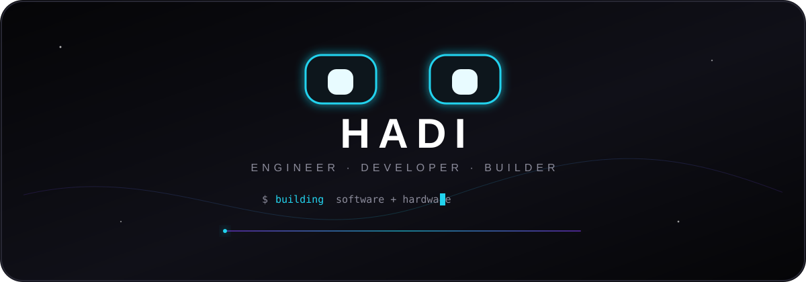

  

 

I'm **Hadi Pashaei (هادی پاشایی)**, an Electrical Engineering student who builds things that move — from firmware on a microcontroller to the interface it talks through. I'd rather take something apart and understand it than stop at the theory.

 

### Stack

| | |
|---|---|
| **Embedded** | Arduino · Embedded C++ · OLED / SSD1306 · Sensors · PLC (Ladder, FBD, STL) |
| **Software** | Kotlin · Python · C++ · JavaScript · HTML / CSS |
| **Other** | Robotics · Linux · Cybersecurity |

 

### Projects

**[EMOchi](https://github.com/hadipashaw/EMOchi)** — an Arduino OLED robot with animated eyes: blinking, emotion states, touch and light reactivity, and a sleep cycle.

**[Uniclass](https://github.com/hadipashaw/Uniclass)** — an Android app (Kotlin, Jetpack Compose) that manages a university class schedule, with smart start-of-class reminders and AI-assisted timetable import.

**[anonymous-telegram-bot](https://github.com/hadipashaw/anonymous-telegram-bot)** — an anonymous messaging bot for Telegram, built on Telegram's serverless platform, with an admin panel and blocklist.

 

> Build it. Break it. Understand it. Improve it.

 

  <strong>Hadi Pashaei</strong> · <a href="https://github.com/hadipashaw">@hadipashaw</a> · <a href="mailto:hadipashaw@gmail.com">hadipashaw@gmail.com</a>

